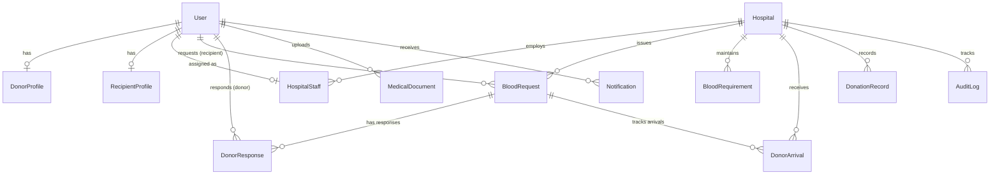

# LIFORA – Full-Stack Architecture & Backend Implementation Plan
**Document Version:** 1.0.0  
**Phase:** 0 (Repository Audit, Architecture Specification & Roadmap)  
**Target Repository:** [LIFORA-Blood-Donation-Network-](https://github.com/tejamurthy-m/LIFORA-Blood-Donation-Network-)  
**Author:** Senior Full-Stack Architect & Engineering Lead  
**Date:** November 2026

---

## 1. Executive Summary & Architecture Overview

LIFORA is an intelligent, mission-critical blood donation and hospital transfusion coordination network designed to bridge donors, recipients, and healthcare institutions. The application connects eligible donors directly to urgent hospital and recipient requests, tracks live donor arrivals, documents clinical donations, and enables centralized hospital blood inventory management.

The frontend has been developed using **React 19, Vite 8, Tailwind CSS v4, Lucide React, and React Router DOM v7**. Currently, all features operate against browser `localStorage` mock stores (`lifora_users`, `lifora_blood_requests_data`, `lifora_donors_data`, `lifora_hospital_portal_data`, etc.).

This document outlines the **Phase 0 Audit and Engineering Specification** required to replace all simulated mock services with a **production-ready Node.js/Express.js backend, PostgreSQL database hosted on Supabase, Prisma ORM, Socket.IO real-time engine, Nodemailer transactional notification engine, and Leaflet OpenStreetMap spatial routing**.

```
+---------------------------------------------------------------------------------------+
|                                    LIFORA CLIENT                                      |
|   React 19 + Vite 8 | Tailwind CSS v4 | React Router v7 | Leaflet Maps | Socket.IO    |
+---------------------------------------------------------------------------------------+
                                           |
                                [HTTPS REST / WSS WebSockets]
                                           v
+---------------------------------------------------------------------------------------+
|                                  EXPRESS.JS BACKEND                                   |
|   Node.js (ESM) | JWT Auth & bcrypt | Express Validator | Winston Logging | Helmet    |
|   Socket.IO Server (Rooms: user_<id>, hospital_<id>, city_<name>, donors_<bloodGroup>)  |
+---------------------------------------------------------------------------------------+
         |                                 |                             |
         v                                 v                             v
+-------------------+             +------------------+         +--------------------+
|    PRISMA ORM     |             | SUPABASE STORAGE |         |     NODEMAILER     |
| PostgreSQL Database|            | Private Buckets: |         | Transfusion Alerts,|
| Hosted on Supabase|             |  - medical-docs  |         | Verification OTPs, |
| Relational Schema |             |  - hospital-docs |         | Status Updates     |
+-------------------+             +------------------+         +--------------------+
```

---

## 2. Existing Repository & Frontend Architecture Audit

### 2.1 Technology Stack in Existing Codebase
- **Build Tool:** Vite 8.0.0
- **Frontend Framework:** React 19.2.0, React DOM 19.2.0
- **Routing:** React Router DOM 7.1.3 (Object route configuration using `BrowserRouter`, `Routes`, `Route`, `Navigate`)
- **Styling:** Tailwind CSS v4.0.0 with custom color palette (`#C1123F` crimson brand primary, `#172033` dark navy, `#FAF9F6` warm background)
- **Icons:** Lucide React 1.16.0
- **Animations:** Framer Motion 12.0.0
- **Charting:** Recharts 2.15.0
- **Maps:** Leaflet 1.9.4 & React Leaflet 5.0.0 (OpenStreetMap tile provider)
- **HTTP Client:** Axios 1.7.9 (pre-configured with `baseURL: import.meta.env.VITE_API_BASE_URL || 'http://localhost:5000/api'`)

### 2.2 Portal Architecture & Navigation Routes
The application has been unified into **Three Core Portals** with a restricted platform operator function:
1. **Donor Portal (`/donor/*`):**
   - `/donor/dashboard`: Donor overview, availability toggle, active nearby emergency requests, donation history, achievements/badges.
   - `/donor/profile`: Personal details, blood group, medical verification submission, contact info.
   - `/donor/notifications`: In-app alert stream (donation requests, matching requisitions).
   - `/donor/settings`: Notification preferences, security settings, password changes.
2. **Recipient Portal (`/recipient/*`):**
   - `/recipient/dashboard`: Active requisitions, request status timeline, donor response tracking.
   - `/recipient/requests/create` & `/requests/create`: Standard blood request creation wizard.
   - `/requests/emergency`: High-urgency blood broadcast wizard.
   - `/find-donors`: Interactive Leaflet map and donor directory with multi-attribute filtering (blood group, city, radius, availability).
3. **Hospital Management Portal (`/hospital/*`):**
   - Single institutional portal with **Role-Based Access Control (RBAC)** across staff roles:
     - `hospital_admin`: Full hospital control, staff management, verification status review, audit logs.
     - `request_manager`: Create, update, and prioritize emergency and elective blood requisitions.
     - `donor_coordinator`: Schedule donor visits, track expected arrivals, manage community outreach.
     - `medical_staff`: Clinical donor screening, phlebotomy recording, hemoglobin/BP logs, donation outcomes.
   - Modules:
     - `HospitalOverviewView`: High-level metrics, blood group requirement distribution, quick actions.
     - `HospitalRequestsView` & `CreateBloodRequestModal`: Creation, status transitions, urgency toggles.
     - `HospitalDonorsView`: Local donor database, invitation dispatch, direct requests.
     - `HospitalArrivalsView`: Live donor arrival status board (`Expected`, `Arrived`, `Screening In-Progress`, `Completed`, `No-Show`, `Cancelled`).
     - `HospitalDonationsView`: Phlebotomy records, bag barcodes, component collection, screening pass/fail.
     - `HospitalTrackingView`: Target vs collected units per blood group.
     - `HospitalStaffView`: Staff roster, add staff modal, remove staff with confirmation dialog.
     - `HospitalNotificationsView`: Hospital-scoped broadcast alerts.
     - `HospitalAnalyticsView`: Monthly collection metrics, fulfillment rate charts.
     - `HospitalProfileView`: Institutional metadata, state blood bank license, head of transfusion medicine.
     - `HospitalSettingsView`: Departmental settings, alert thresholds.
4. **Lightweight Platform Operator Function (`/admin/verification`):**
   - Restricted operator view to inspect pending hospital applications and approve/reject hospital accounts without maintaining a bloated separate super admin portal.

### 2.3 Current Frontend Services & Mock Stores Audit

| Service File | Current Mock Mechanism | Real Backend Transition Requirement |
|---|---|---|
| `src/services/api.js` | Axios instance pointing to `VITE_API_BASE_URL` with auth token interceptor | Point to real Express server; standardize token key (`lifora_token`); handle 401 token refresh. |
| `src/services/authService.js` | Mock user array in `localStorage` (`lifora_users`, `lifora_current_user`, `lifora_auth_token`) | Replace with `/api/v1/auth/login`, `/register`, `/me`, `/refresh-token`, `/logout`. Store JWT securely. |
| `src/services/donorService.js` | `localStorage` array (`lifora_donors_data`), JS array filters for radius/blood group | Replace with `/api/v1/donors` (PostgreSQL geospatial query), `/api/v1/donors/:id`, `/api/v1/donors/:id/availability`. |
| `src/services/requestService.js` | `localStorage` array (`lifora_blood_requests_data`), mock tracking IDs | Replace with `/api/v1/requests`, `/api/v1/requests/:id`, `/api/v1/requests/:id/accept`, `/api/v1/requests/track/:code`. |
| `src/services/hospitalService.js` | `localStorage` array (`lifora_hospitals_data`) | Replace with `/api/v1/hospitals`, `/api/v1/hospitals/:id`, `/api/v1/hospitals/:id/status` (platform review). |
| `src/services/hospitalPortalService.js` | Nested JSON object in `localStorage` (`lifora_hospital_portal_data`) covering 11 sub-entities | Replace with dedicated endpoints for hospital staff, arrivals, clinical donations, and inventory tracking. |
| `src/services/adminNotificationService.js` | `localStorage` notification queue | Replace with `/api/v1/notifications` + Socket.IO real-time emission. |

### 2.4 Critical Gaps & Discrepancies Identified During Audit
1. **Token Inconsistency:** `src/services/api.js` looks for `localStorage.getItem('lifora_token')`, but `src/services/authService.js` was saving `lifora_auth_token`. In Phase 2, this must be unified to a single token key across all services.
2. **Missing Backend Directory:** The repository currently has only frontend code in root. The backend will be organized cleanly in a dedicated `/backend` directory to keep full-stack concerns separated while preserving the root build scripts.
3. **Geospatial Distance Calculation:** The frontend currently calculates distance using a randomized mock offset (`distanceKm = (1 + Math.random() * 6)`). The backend will implement true Haversine distance calculations and spatial indexing using latitude/longitude.
4. **Medical Report Storage:** The frontend currently simulates file upload via string filenames. Real medical reports must be securely streamed to a private Supabase Storage bucket with signed URL generation for verified staff/admin access only.

---

## 3. Target Hybrid Architecture

The application will operate on a hybrid cloud architecture:
- **Client Tier:** React 19 SPA running on Vite, hosted on Vercel.
- **Application Tier:** Node.js + Express.js REST API with Socket.IO WebSocket server, hosted on Render.
- **Persistence Tier:** PostgreSQL database hosted on Supabase, managed via Prisma ORM.
- **Object Storage Tier:** Supabase Storage (private S3-compatible buckets with authenticated signed URLs).
- **Notification Tier:** Nodemailer via secure SMTP for emails; Socket.IO for in-app push alerts; modular gateway adapter for SMS/WhatsApp.
- **Geographic Services Tier:** OpenStreetMap tiles via Leaflet for visualization + Haversine spatial querying in PostgreSQL.

---

## 4. Database Schema Design (Prisma ORM)

The complete PostgreSQL database schema will be modeled using Prisma. Below is the relational architecture:



### 4.1 Schema Definition (`backend/prisma/schema.prisma`)

```prisma
datasource db {
  provider = "postgresql"
  url      = env("DATABASE_URL")
  directUrl = env("DIRECT_URL")
}

generator client {
  provider = "prisma-client-js"
}

// -------------------------------------------------------------
// ENUMS
// -------------------------------------------------------------

enum UserRole {
  DONOR
  RECIPIENT
  HOSPITAL
  SUPER_ADMIN
}

enum StaffRole {
  HOSPITAL_ADMIN
  REQUEST_MANAGER
  DONOR_COORDINATOR
  MEDICAL_STAFF
}

enum BloodGroup {
  A_POSITIVE      @map("A+")
  A_NEGATIVE      @map("A-")
  B_POSITIVE      @map("B+")
  B_NEGATIVE      @map("B-")
  AB_POSITIVE     @map("AB+")
  AB_NEGATIVE     @map("AB-")
  O_POSITIVE      @map("O+")
  O_NEGATIVE      @map("O-")
}

enum VerificationStatus {
  PENDING
  VERIFIED
  CLARIFICATION_REQUESTED
  REJECTED
  SUSPENDED
}

enum RequestUrgency {
  NORMAL
  URGENT
  EMERGENCY
}

enum RequestStatus {
  PENDING
  IN_PROGRESS
  PARTIALLY_FULFILLED
  FULFILLED
  CANCELLED
  CLOSED
}

enum ArrivalStatus {
  EXPECTED
  ARRIVED
  SCREENING_IN_PROGRESS
  COMPLETED
  NO_SHOW
  CANCELLED
}

enum DonationType {
  WHOLE_BLOOD
  PACKED_RED_CELLS
  PLATELETS
  PLASMA
  CRYOPRECIPITATE
}

enum NotificationType {
  EMERGENCY_REQUEST
  DONOR_MATCH
  VERIFICATION_UPDATE
  ARRIVAL_STATUS
  DONATION_COMPLETED
  STAFF_INVITE
  SYSTEM_ALERT
}

// -------------------------------------------------------------
// USER & AUTHENTICATION
// -------------------------------------------------------------

model User {
  id               String       @id @default(uuid())
  email            String       @unique
  passwordHash     String
  fullName         String
  phone            String       @unique
  role             UserRole
  city             String
  area             String?
  avatarUrl        String?
  isActive         Boolean      @default(true)
  isEmailVerified  Boolean      @default(false)
  isPhoneVerified  Boolean      @default(false)
  createdAt        DateTime     @default(now())
  updatedAt        DateTime     @updatedAt

  // Refresh tokens for JWT rotation
  refreshTokens    RefreshToken[]

  // Polymorphic profile associations
  donorProfile     DonorProfile?
  recipientProfile RecipientProfile?
  staffProfile     HospitalStaff?

  // Activity relations
  createdRequests  BloodRequest[]      @relation("RequesterUsers")
  donorResponses   DonorResponse[]
  uploadedDocs     MedicalDocument[]
  notifications    Notification[]
  auditLogs        AuditLog[]          @relation("UserAuditLogs")

  @@index([email])
  @@index([phone])
  @@index([city])
}

model RefreshToken {
  id        String   @id @default(uuid())
  tokenHash String   @unique
  userId    String
  user      User     @relation(fields: [userId], references: [id], onDelete: Cascade)
  expiresAt DateTime
  createdAt DateTime @default(now())

  @@index([userId])
}

// -------------------------------------------------------------
// DONOR PROFILES & MEDICAL VERIFICATION
// -------------------------------------------------------------

model DonorProfile {
  id                   String             @id @default(uuid())
  userId               String             @unique
  user                 User               @relation(fields: [userId], references: [id], onDelete: Cascade)
  bloodGroup           BloodGroup
  latitude             Float?
  longitude            Float?
  isAvailable          Boolean            @default(true)
  emergencyReady       Boolean            @default(true)
  badge                String             @default("New Donor")
  totalDonations       Int                @default(0)
  lastDonationDate     DateTime?
  profileCompletion    Int                @default(80)
  bio                  String?
  age                  Int?
  verificationStatus   VerificationStatus @default(PENDING)
  createdAt            DateTime           @default(now())
  updatedAt            DateTime           @updatedAt

  arrivals             DonorArrival[]
  donationRecords      DonationRecord[]

  @@index([bloodGroup, isAvailable])
  @@index([latitude, longitude])
}

model MedicalDocument {
  id                   String             @id @default(uuid())
  userId               String
  user                 User               @relation(fields: [userId], references: [id], onDelete: Cascade)
  docType              String             // e.g. Pathology Report, Govt Blood Donor Card
  docNumber            String?
  fileUrl              String             // Private Supabase Storage object key
  fileMimeType         String
  fileSizeBytes        Int
  status               VerificationStatus @default(PENDING)
  notes                String?
  clarificationMessage String?
  verifiedAt           DateTime?
  verifiedBy           String?            // Staff / Operator ID
  createdAt            DateTime           @default(now())
  updatedAt            DateTime           @updatedAt

  @@index([userId])
  @@index([status])
}

// -------------------------------------------------------------
// RECIPIENT PROFILES
// -------------------------------------------------------------

model RecipientProfile {
  id             String   @id @default(uuid())
  userId         String   @unique
  user           User     @relation(fields: [userId], references: [id], onDelete: Cascade)
  emergencyPhone String?
  hospitalName   String?
  createdAt      DateTime @default(now())
  updatedAt      DateTime @updatedAt
}

// -------------------------------------------------------------
// HOSPITAL & INSTITUTIONAL MANAGEMENT
// -------------------------------------------------------------

model Hospital {
  id                 String             @id @default(uuid())
  name               String
  licenseNumber      String             @unique
  registrationNumber String?            @unique
  address            String
  city               String
  state              String             @default("Maharashtra")
  pincode            String?
  latitude           Float?
  longitude          Float?
  contactPhone       String
  officialEmail      String             @unique
  verificationStatus VerificationStatus @default(PENDING)
  accreditation      String?            @default("NABH Accredited Transfusion Centre")
  bedCapacity        Int                @default(200)
  logoUrl            String?
  headDoctorName     String?
  headDoctorQual     String?
  headDoctorPhone    String?
  headDoctorEmail    String?
  facilities         String[]           @default(["Whole Blood", "PRBC", "Platelets", "FFP"])
  createdAt          DateTime           @default(now())
  updatedAt          DateTime           @updatedAt

  // Staff and operational modules
  staff              HospitalStaff[]
  requests           BloodRequest[]
  requirements       BloodRequirement[]
  arrivals           DonorArrival[]
  donations          DonationRecord[]
  auditLogs          AuditLog[]

  @@index([city])
  @@index([verificationStatus])
}

model HospitalStaff {
  id          String      @id @default(uuid())
  hospitalId  String
  hospital    Hospital    @relation(fields: [hospitalId], references: [id], onDelete: Cascade)
  userId      String      @unique
  user        User        @relation(fields: [userId], references: [id], onDelete: Cascade)
  role        StaffRole   @default(MEDICAL_STAFF)
  department  String      @default("Transfusion Medicine")
  status      String      @default("active") // active | suspended
  joinedDate  DateTime    @default(now())
  lastActive  DateTime?

  @@index([hospitalId])
  @@index([role])
}

// -------------------------------------------------------------
// BLOOD REQUESTS & MATCHING
// -------------------------------------------------------------

model BloodRequest {
  id                     String         @id @default(uuid())
  trackingCode           String         @unique // e.g. LIF-8912
  patientName            String
  bloodGroup             BloodGroup
  unitsRequired          Int            @default(1)
  unitsFulfilled         Int            @default(0)
  urgency                RequestUrgency @default(NORMAL)
  requiredDate           DateTime
  locationDescription    String
  city                   String
  latitude               Float?
  longitude              Float?
  contactPerson          String
  contactPhone           String
  additionalInstructions String?
  status                 RequestStatus  @default(PENDING)
  createdAt              DateTime       @default(now())
  updatedAt              DateTime       @updatedAt

  // Optional associations
  requesterId            String?
  requester              User?          @relation("RequesterUsers", fields: [requesterId], references: [id], onDelete: SetNull)
  hospitalId             String?
  hospital               Hospital?      @relation(fields: [hospitalId], references: [id], onDelete: SetNull)

  // Tracking and responses
  responses              DonorResponse[]
  arrivals               DonorArrival[]

  @@index([bloodGroup, status, urgency])
  @@index([city])
  @@index([trackingCode])
}

model DonorResponse {
  id             String       @id @default(uuid())
  requestId      String
  request        BloodRequest @relation(fields: [requestId], references: [id], onDelete: Cascade)
  donorId        String
  donor          User         @relation(fields: [donorId], references: [id], onDelete: Cascade)
  status         String       @default("ACCEPTED") // ACCEPTED, DECLINED, COMPLETED
  respondedAt    DateTime     @default(now())
  etaMinutes     Int?

  @@unique([requestId, donorId])
  @@index([donorId])
}

// -------------------------------------------------------------
// HOSPITAL OPERATIONS: INVENTORY, ARRIVALS & CLINICAL OUTCOMES
// -------------------------------------------------------------

model BloodRequirement {
  id             String     @id @default(uuid())
  hospitalId     String
  hospital       Hospital   @relation(fields: [hospitalId], references: [id], onDelete: Cascade)
  bloodGroup     BloodGroup
  targetUnits    Int
  collectedUnits Int        @default(0)
  urgency        RequestUrgency @default(NORMAL)
  status         String     @default("Active") // Active | Fulfilled | Critical
  updatedAt      DateTime   @updatedAt

  @@unique([hospitalId, bloodGroup])
  @@index([hospitalId])
}

model DonorArrival {
  id            String        @id @default(uuid())
  hospitalId    String
  hospital      Hospital      @relation(fields: [hospitalId], references: [id], onDelete: Cascade)
  donorId       String
  donor         DonorProfile  @relation(fields: [donorId], references: [id], onDelete: Cascade)
  requestId     String?
  request       BloodRequest? @relation(fields: [requestId], references: [id], onDelete: SetNull)
  eta           String        // e.g. "15 mins", "14:30"
  arrivedTime   DateTime?
  status        ArrivalStatus @default(EXPECTED)
  assignedStaff String?       // Staff name
  createdAt     DateTime      @default(now())
  updatedAt     DateTime      @updatedAt

  @@index([hospitalId, status])
}

model DonationRecord {
  id               String       @id @default(uuid())
  hospitalId       String
  hospital         Hospital     @relation(fields: [hospitalId], references: [id], onDelete: Cascade)
  donorId          String
  donor            DonorProfile @relation(fields: [donorId], references: [id], onDelete: Cascade)
  bloodGroup       BloodGroup
  unitsDonated     Int          @default(1)
  donationType     DonationType @default(WHOLE_BLOOD)
  screeningPassed  Boolean      @default(true)
  hemoglobinLevel  Float?       // g/dL (e.g. 13.8)
  bloodPressure    String?      // e.g. "120/80"
  pulseRate        Int?         // bpm (e.g. 72)
  bagBarcode       String?      // e.g. "BAG-2026-9921"
  deferralReason   String?      // If screening failed
  verifiedBy       String       // Staff Name or ID
  donationDate     DateTime     @default(now())

  @@index([hospitalId])
  @@index([donorId])
}

// -------------------------------------------------------------
// NOTIFICATIONS & AUDIT LOGS
// -------------------------------------------------------------

model Notification {
  id        String           @id @default(uuid())
  userId    String
  user      User             @relation(fields: [userId], references: [id], onDelete: Cascade)
  type      NotificationType
  title     String
  message   String
  metadata  Json?
  isRead    Boolean          @default(false)
  createdAt DateTime         @default(now())

  @@index([userId, isRead])
}

model AuditLog {
  id         String    @id @default(uuid())
  hospitalId String?
  hospital   Hospital? @relation(fields: [hospitalId], references: [id], onDelete: SetNull)
  userId     String?
  user       User?     @relation("UserAuditLogs", fields: [userId], references: [id], onDelete: SetNull)
  action     String
  actorName  String
  target     String
  notes      String?
  createdAt  DateTime  @default(now())

  @@index([hospitalId])
  @@index([createdAt])
}
```

---

## 5. Complete REST API Specifications & Contracts

### 5.1 Base URL & Standards
- **Base URL:** `http://localhost:5000/api/v1` (Dev) / `https://lifora-backend.onrender.com/api/v1` (Prod)
- **Content-Type:** `application/json` (or `multipart/form-data` for uploads)
- **Standard Success Response:**
  ```json
  {
    "success": true,
    "data": { ... },
    "message": "Operation successful"
  }
  ```
- **Standard Error Response:**
  ```json
  {
    "success": false,
    "error": {
      "code": "VALIDATION_FAILED",
      "message": "Detailed error explanation",
      "details": [ ... ]
    }
  }
  ```

### 5.2 Endpoints Breakdown

#### Module 1: Authentication & Account Management (`/api/v1/auth`)
- `POST /register`: Register Donor, Recipient, or Hospital Account. Hashes passwords with `bcrypt` (12 rounds).
- `POST /login`: Validates credentials, returns JWT Access Token (15 min lifespan) + HTTP-only Refresh Token (7 days).
- `POST /refresh-token`: Rotates access token using stored refresh token.
- `GET /me`: Returns profile of authenticated user, including attached roles and permissions.
- `PUT /profile`: Updates user personal metadata (name, phone, area, bio, avatar).
- `PUT /change-password`: Verifies existing password and updates to new password.
- `POST /logout`: Invalidates active refresh token.

#### Module 2: Donors & Search (`/api/v1/donors`)
- `GET /`: Query donors with spatial distance calculation, filtered by `bloodGroup`, `city`, `onlyAvailable`, `maxDistance`, and `sortBy`.
- `GET /:id`: Fetch detailed public donor profile.
- `PATCH /:id/availability`: Toggle donor availability status (`isAvailable: true/false`).
- `POST /:id/direct-request`: Dispatch direct SMS/email notification to a specific donor.

#### Module 3: Medical Verification (`/api/v1/verifications`)
- `POST /upload`: Upload donor blood report / photo ID (`multipart/form-data`) to Supabase Storage private bucket.
- `GET /my-document`: Retrieve the current donor's verification document status and secure signed URL.
- `GET /queue`: (Restricted) List all pending donor verification submissions for review.
- `PATCH /:id/review`: Approve, request clarification, or reject document with auditor notes.

#### Module 4: Blood Requests & Tracking (`/api/v1/requests`)
- `POST /`: Create standard or emergency blood request. Auto-generates unique `trackingCode` (e.g. `LIF-4819`).
- `GET /`: Filter requests by `bloodGroup`, `urgency`, `status`, `city`, or `requesterId`.
- `GET /:id`: Get request details with real-time response counters and progress timeline.
- `GET /track/:trackingCode`: Public tracking endpoint for recipients and hospitals.
- `POST /:id/accept`: Donor accepts request. Broadcasts notification to requester and hospital.
- `PATCH /:id/status`: Transition request status (`PENDING` -> `IN_PROGRESS` -> `FULFILLED` -> `CLOSED`).

#### Module 5: Hospital Portal Operations (`/api/v1/hospitals`)
- `GET /profile`: Retrieve institutional profile for the logged-in hospital staff member.
- `PUT /profile`: Update hospital metadata, bed capacity, and transfusion head details.
- `GET /overview`: Retrieve calculated dashboard summary metrics (active requests, expected arrivals, units collected, requirement deficit).
- `GET /staff`: Roster of hospital staff members with assigned RBAC roles.
- `POST /staff`: (Hospital Admin only) Create/invite staff member account.
- `DELETE /staff/:id`: (Hospital Admin only) Remove staff account and reassign active shifts.
- `GET /arrivals`: List expected and active donor arrivals.
- `PATCH /arrivals/:id/status`: Update arrival state (`ARRIVED`, `SCREENING_IN_PROGRESS`, `COMPLETED`, `NO_SHOW`).
- `GET /donations`: List recorded clinical phlebotomy outcomes.
- `POST /donations`: Record phlebotomy outcome, hemoglobin level, BP, bag barcode, and verification.
- `GET /requirements`: Current hospital blood group target vs collected units.
- `PUT /requirements`: Update target units and urgency level per blood group.
- `GET /audit-logs`: Institutional compliance audit log feed.

#### Module 6: Platform Verification (`/api/v1/platform-admin`)
- `GET /hospitals/pending`: List all hospital registration applications awaiting platform verification.
- `PATCH /hospitals/:id/verify`: Approve or Reject hospital application. On approval, unlocks Hospital Portal access for staff.

#### Module 7: Notifications (`/api/v1/notifications`)
- `GET /`: Retrieve user-specific notification stream with unread badge counter.
- `PATCH /:id/read`: Mark single notification as read.
- `PATCH /mark-all-read`: Mark all notifications as read.

---

## 6. Real-Time Socket.IO Protocol Specification

The WebSocket layer enables instant multi-party coordination during critical transfusion emergencies:

### 6.1 Room Partitioning Strategy
- `user_{userId}`: Private room for personal alerts (direct requests, report verification approval, status change).
- `hospital_{hospitalId}`: Shared institutional room for hospital staff (arrival updates, new request fulfillments).
- `city_{cityName}`: Geographic broadcast room for new emergency blood requests in that city.
- `blood_{bloodGroup}`: Targeted room for donors matching an urgent requisition.

### 6.2 WebSocket Event Matrix

| Event Name | Direction | Payload | Trigger & Action |
|---|---|---|---|
| `blood_request:created` | Server -> `city_{city}`, `blood_{group}` | `{ request: BloodRequest, distanceKm: number }` | Broadcasts emergency card popup to nearby available donors. |
| `donor:responded` | Server -> `user_{requesterId}`, `hospital_{hospitalId}` | `{ requestId, donor: { name, bloodGroup, eta } }` | Updates request response count and adds to expected arrivals. |
| `arrival:status_changed` | Server -> `hospital_{hospitalId}` | `{ arrivalId, status, donorName, time }` | Live updates the Hospital Arrival board without manual refresh. |
| `donation:recorded` | Server -> `hospital_{hospitalId}` | `{ donationRecord, updatedRequirements }` | Increments hospital collected units and updates inventory charts. |
| `notification:push` | Server -> `user_{userId}` | `{ notification: Notification }` | Increments topbar unread notification bell count. |

---

## 7. Storage, Security & Compliance Architecture

### 7.1 Private Supabase Storage & Signed URLs
- **Bucket: `medical-documents` (Private):** Medical reports contain protected health information (PHI). They are stored in an encrypted private Supabase bucket.
- **Signed URL Access:** The backend never exposes public links to blood reports. Clients request an authenticated signed URL with a 15-minute time-to-live (TTL) generated via `@supabase/supabase-js`.
- **MIME Type Whitelist:** Restricted strictly to `application/pdf`, `image/jpeg`, `image/png`. Max file size: 5 MB.

### 7.2 Security Best Practices
- **Password Security:** Passwords hashed using `bcrypt` with a minimum salt round cost of 12.
- **JWT Protection:** Signed using `RS256` or `HS256` with strict expiration. Refresh tokens stored with SHA-256 hashes in PostgreSQL.
- **Rate Limiting:** `express-rate-limit` configured: 100 requests / 15 min globally; 10 attempts / 15 min on auth endpoints.
- **HTTP Security Headers:** `helmet` enabled to prevent XSS, clickjacking, and MIME sniffing. CORS restricted to authorized frontend origins.
- **Input Sanitization:** All incoming requests validated using `express-validator` and `zod` schemas.

---

## 8. Phased Implementation Roadmap

To ensure zero downtime, verified stability, and frontend protection, development will proceed in **15 Sequential Phases**:

```
[Phase 0: Audit & Plan] -> [Phase 1: Backend Setup] -> [Phase 2: Database & Prisma]
           |
           v
[Phase 3: Auth & JWT]   -> [Phase 4: Donor API]     -> [Phase 5: Medical Verification]
           |
           v
[Phase 6: Requests API] -> [Phase 7: Hospital API]  -> [Phase 8: Staff & Operations]
           |
           v
[Phase 9: Platform Admin]->[Phase 10: Real-time IO]-> [Phase 11: Email & Alerts]
           |
           v
[Phase 12: Maps Integration] -> [Phase 13: E2E Integration] -> [Phase 14: Hardening]
           |
           v
[Phase 15: Deployment & Documentation]
```

### Detailed Phase Milestones:
- **Phase 0 (CURRENT):** Complete Repository Audit, Backend Implementation Plan, Schema Draft & Clarifications.
- **Phase 1: Backend Foundation:** Node.js, Express.js, TypeScript/ESM setup, modular route/controller/service structure, error middleware, Winston logging.
- **Phase 2: Supabase & Prisma Setup:** PostgreSQL connection on Supabase, migrations, Prisma Client generation, database seeders for initial demo users and hospitals.
- **Phase 3: Authentication & Security:** Password hashing, JWT access/refresh token rotation, role guards (`donor`, `recipient`, `hospital`, `super_admin`).
- **Phase 4: Donor Management API:** Geospatial queries, availability switch, profile management, direct contact triggers.
- **Phase 5: Medical Report Storage & Verification:** Supabase Storage bucket configuration, signed URL generator, review workflow with audit trail.
- **Phase 6: Blood Request Engine:** Multi-stage request lifecycle (`PENDING` -> `FULFILLED`), tracking code generation, donor response acceptance.
- **Phase 7: Hospital Portal API:** Hospital registration, profile management, institution-level metrics.
- **Phase 8: Hospital Staff & Operations API:** Multi-staff accounts, RBAC enforcement, donor arrivals board, clinical donation phlebotomy logs, blood inventory tracking.
- **Phase 9: Platform Operator Verification API:** Lightweight hospital application approval/rejection endpoint with immutable audit logging.
- **Phase 10: Real-Time Communication (Socket.IO):** Live alerts, room-based broadcasting, donor arrival status streaming.
- **Phase 11: Transactional Notifications (Nodemailer):** SMTP integration, emergency blood match emails, verification status alerts.
- **Phase 12: Maps & Spatial Integration:** Haversine distance calculations, coordinate verification, Leaflet frontend sync.
- **Phase 13: Frontend-to-Backend Full-Stack Integration:** Replacing mock services in React with live Axios API calls while preserving 100% of UI/UX.
- **Phase 14: Security Hardening & Automated Testing:** Unit tests for controllers, Jest/Supertest API integration tests, rate limiting, sanitization checks.
- **Phase 15: Deployment & CI/CD Documentation:** Deploying backend to Render, configuring Supabase PostgreSQL in production, Vercel frontend environment variables, comprehensive handoff documentation.

---

## 9. Missing Information, Credentials Checklist & Questions for User Approval

Before proceeding to Phase 1 and Phase 2, the following configuration parameters and external credentials are required:

### 9.1 Required Credentials & Services Checklist

| Service / Resource | Purpose | Status / Action Needed |
|---|---|---|
| **Supabase Project URL & Database Connection String** | PostgreSQL database hosting & Prisma migrations | Need Supabase `DATABASE_URL` (Transaction pooler) and `DIRECT_URL` (Direct connection for migrations). Alternatively, can use local PostgreSQL or Supabase CLI for development. |
| **Supabase Service Role Key & Storage Bucket** | Private bucket access for medical document storage | Need Supabase `SUPABASE_URL` and `SUPABASE_SERVICE_ROLE_KEY`. |
| **SMTP Email Credentials (Nodemailer)** | Transactional emails (donor alerts, verification status) | Need SMTP Host (e.g. Gmail SMTP, SendGrid, Mailgun), Port, Username, and Password / App Key. (Ethereal test account can be used during local testing). |
| **JWT Secret Keys** | Signing authentication tokens | Can be automatically generated as secure 256-bit random secrets in `.env`. |
| **SMS / WhatsApp Gateway (Optional)** | Instant donor SMS notifications | Please confirm if you wish to integrate Twilio / Fast2SMS, or if simulated logging + email notifications are sufficient for this version. |

### 9.2 Clarification Questions for Approval

1. **Database Hosting:** Do you already have an existing Supabase project created, or would you like me to guide you through creating one, or start with local development environment variables first?
2. **SMS Notification Provider:** For urgent blood requests, should we integrate a live SMS provider (e.g. Twilio) immediately, or is Nodemailer email alerts + in-app real-time Socket.IO alerts preferred for the primary notification channel?
3. **Medical Report Review Workflow:** When a donor uploads a blood report, should any hospital's `medical_staff` be permitted to verify the donor, or should verification be restricted exclusively to the platform operator / assigned hospital admin?
4. **Approval to Proceed:** Please review this Phase 0 Implementation Plan. Upon your approval, we will initiate **Phase 1: Backend Foundation Setup** without making any visual modifications to your existing React frontend.
